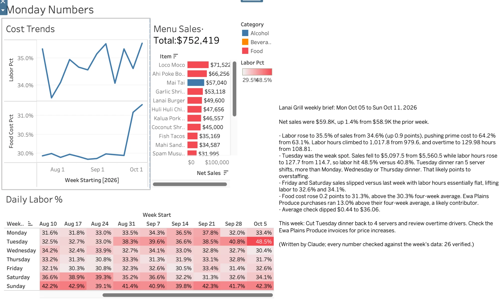
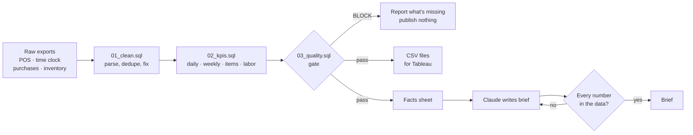

# Monday Numbers: restaurant KPI dashboard with a fact-checked AI brief

**Takes a week of messy restaurant exports (POS sales, time clock, purchases, inventory), cleans them with SQL, refuses to publish if the data is incomplete, calculates the numbers a GM reviews every Monday, and has Claude write a short brief explaining what changed, with code checking every number Claude quotes. Dashboard in Tableau.**

📊 **[View the live dashboard on Tableau Public](https://public.tableau.com/app/profile/norman.kau/viz/MondayNumbersProject/MondayNumbers)**

Built around a problem common in restaurants, where Monday morning means a manager exporting reports, rebuilding the same spreadsheet, and still not being able to say *why* labor cost went up.



| | |
|---|---|
| **Cleans real-world mess** | Two date formats, "$1,234.50" text amounts, a re-exported day, voids, inconsistent employee names, a time clock that gets overnight shifts wrong, a forgotten clock-out. |
| **Won't publish bad numbers** | A data-quality gate **blocks** the report if a day is missing or sales don't reconcile with the POS's own totals, and lists everything the cleaning fixed. |
| **The KPIs managers use** | Net sales, guests, average check, labor %, sales per labor hour, overtime, food cost %, bar cost %, prime cost, menu mix, and week-over-week change. |
| **Explains the week** | Claude writes a 30-second brief: what moved, the likely reason, and what to do this week. |
| **Fact-checks the AI** | Every number in the brief is matched back to the data. Anything that doesn't match is sent back for a rewrite, then flagged if it still fails. |
| **Tested** | 16 tests on the cleaning, the gate, overtime, the planted stories and the number check. |

## The weekly brief (real output)

> Net sales were $59.8K, up 1.4% from $58.9K the prior week.
>
> - Labor rose to 35.5% of sales from 34.6% (up 0.9 points), pushing prime cost to 64.2% from 63.1%. Labor hours climbed to 1,017.8 from 979.6, and overtime to 129.98 hours from 108.81.
> - Tuesday was the weak spot: sales fell to $5,097.5 from $5,560.5 while labor hours rose to 127.7 from 114.7, so labor hit 48.5% versus 40.8%. Tuesday dinner ran 5 server shifts, more than Monday, Wednesday or Thursday dinner, which likely points to overstaffing.
> - Food cost rose 0.2 points to 31.3%, above the 30.3% four-week average. Ewa Plains Produce purchases ran 13.0% above their four-week average, a likely contributor.
> - *(two more bullets)*
>
> This week: Cut Tuesday dinner back to 4 servers and review overtime drivers. Check the Ewa Plains Produce invoices for price increases.
>
> *(Written by Claude; every number checked against the week's data: 26 verified.)*

Full text: [docs/sample-brief.txt](docs/sample-brief.txt). Two problems were **planted** in the data (an overstaffed Tuesday, and a produce supplier raising prices), and the brief found both without being told. Cost: about **4¢** per brief.

## The data-quality gate

On the raw exports, Saturday's sales file is missing, as if the export failed. Without the gate, food cost for the week reads **38.7%** instead of 31.3%, because a full week of purchases is compared with six days of sales. A manager would chase a problem that doesn't exist. So the run stops:

| Severity | Check | Detail |
|---|---|---|
| **BLOCK** | Missing POS day | Sat Oct 10: POS daily summary shows $11,250.00 in sales, but the product-mix export has no rows for this day |
| WARN | Missing clock-out | Duke Kamaka (Line Cook), Thu Oct 08 15:36: hours estimated at 8.1 from a typical dinner shift. Have the manager confirm. |
| FIXED | Duplicate POS rows removed | 23 rows re-exported for Wed Sep 16 (identical copies, kept one) |
| FIXED | Overnight clock-outs corrected | 185 shifts ended after midnight but were exported with the clock-in date; one day added |
| FIXED | POS formats standardized | 1,141 rows used MM/DD/YYYY dates and "$1,234.50" text amounts (before the POS update); converted |

When the late file arrives, the same run passes and publishes. Full reports: [blocked](docs/sample-quality-report-blocked.md) · [passed](docs/sample-quality-report-passed.md).

## What the dashboard shows

- **Cost trends:** labor % and food cost % by week. Food cost steps up from about 30% to 31.3% when produce prices rise.
- **Daily labor % heatmap:** one square per day. The overstaffed Tuesday is the darkest square (48.5%). Two patterns nobody planted also appear: **Tuesdays run hot every week from September** (summer traffic ended, minimum crew didn't), and **Sundays sit at 40–44%** because staff cross 40 hours by the weekend: 55% of Sunday hours are overtime.
- **Menu sales:** item mix with a total (a Tableau FIXED calculation). The Mai Tai is the #3 seller, high-margin revenue at about 21% bar cost.

## How it works



| File | Does |
|---|---|
| [`sql/01_clean.sql`](sql/01_clean.sql) | Loads every export as text, then parses dates and amounts, removes re-exported rows, fixes overnight shifts, estimates a missing clock-out, and calculates overtime past 40 hours a week. |
| [`sql/02_kpis.sql`](sql/02_kpis.sql) | Daily and weekly KPIs; cost of goods = opening inventory + purchases − closing inventory. |
| [`sql/03_quality.sql`](sql/03_quality.sql) | The gate: BLOCK / WARN / FIXED rows. |
| [`monday_numbers/brief.py`](monday_numbers/brief.py) | Builds a small facts sheet in SQL, asks Claude for the brief, and checks every number against it. |
| [`monday_numbers/run.py`](monday_numbers/run.py) | Runs it all. |

**Design choices worth calling out:**
- **SQL does the math, Claude does the words.** Claude never sees raw data or calculates anything. It gets a one-page facts sheet and is told to quote only those numbers. Code enforces that.
- **Wrong numbers are worse than late numbers.** The gate blocks rather than guessing, and says exactly what to fix.
- **Every fix is disclosed.** Nothing is silently changed: duplicates, format conversions and estimated hours are all listed.
- **Load as text, then parse.** Exports change format without warning (this POS did, mid-period). Reading everything as text first means a format change can't silently corrupt a column.

## In a real restaurant

- **Data in, automatically:** a POS like Toast can deliver scheduled nightly exports (or data through its API, typically via a partner integration). Time clock and invoice data often come from the same platform. The weekly inventory count is the one manual step.
- **No POS?** Scale down to five numbers a day: register Z-report total, guest count, labor hours, invoices and a Sunday count. Photograph the paper and let AI read it (see [Paper Chaser](https://github.com/NormStormm/paper-chaser)), or use a 2-minute phone form. You lose item mix but keep labor %, food cost % and the brief.
- **Sending it Monday morning:** a scheduler (n8n like [Shift Desk](https://github.com/NormStormm/shift-desk), or GitHub Actions) runs the pipeline at 6 a.m., emails the brief, or emails what's missing if the gate blocks. Tableau Public can't refresh from local files, so a live version would write to a Google Sheet that Tableau re-reads daily.

## The sample data

[`tools/make_sample_data.py`](tools/make_sample_data.py) generates 12 weeks (Jul 20 – Oct 11, 2026) for **Lanai Grill, a fictitious hotel restaurant**: a POS product mix (22 items), a POS daily summary, 1,800+ time-clock punches for 23 made-up employees, purchases from fictitious vendors, and weekly inventory counts. Hawaii's 2026 minimum wage ($16) and general excise tax are used for realism. The mess and the stories are planted on purpose and listed in [`tests/known_facts.json`](tests/known_facts.json), so the tests can check that the pipeline finds them.

## Run it yourself

Needs Python 3.10+ (and a [Claude API key](https://console.anthropic.com/) for the brief only).

```bash
python3 -m venv .venv && .venv/bin/pip install -r requirements.txt
.venv/bin/python tools/make_sample_data.py           # (re)create the sample exports
.venv/bin/python -m monday_numbers.run --no-brief    # -> BLOCKED: Saturday is missing
cp data/late/*.csv data/raw/                          # the late file arrives
.venv/bin/python -m monday_numbers.run               # -> passes; writes output/tableau/*.csv and the brief
.venv/bin/python -m pytest -q                         # 16 tests, no API calls
```

The dashboard's data files are also in [`docs/tableau-data/`](docs/tableau-data/). Details: [docs/runbook.md](docs/runbook.md).

## Limits and next steps
- **Synthetic data:** realistic patterns, but generated. The overtime is exaggerated by how the fake schedule rotates staff.
- **The brief only looks back four weeks,** so it misses longer patterns the heatmap shows (Tuesdays since September, Sunday overtime). Next: add 12-week same-day trends and overtime by day to its facts sheet.
- **Food cost is weekly,** from inventory counts. Item-level theoretical cost would need recipe costing.

*All data is fictitious: no real restaurant, employee or guest data was used.*
